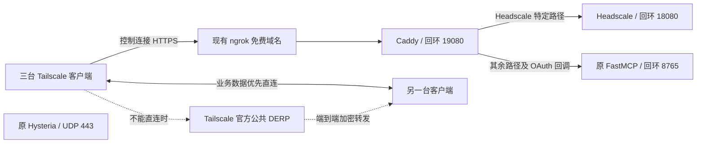

# Headscale：Vultr + 免费 ngrok + 公共 DERP

更新日期：2026-10-29（Asia/Shanghai）。已确认条件：Vultr 公网 VPS，1 核 / 1 GB / 25 GB；已有 Hysteria、FastMCP；ngrok 免费套餐、一个现有开发域名；客户端最多三台。

**当前状态：用户决定不再自建，已回传 Headscale、Headplane 均为 `inactive` / `disabled`。共享 Caddy 保留用于现有 FastMCP，配置与数据未删除。** 停止、重新启动和恢复开机自启的步骤见 [教程](./安装与管理教程.md#service-lifecycle)。

以下保留已验证的部署方案与重建参考：Headscale 经现有 ngrok 域名接入，使用 Tailscale 官方公共 DERP，不自建中继、不做备份；不购买域名、不增加 DNS 服务、不升级 ngrok 套餐。完整操作步骤见 [安装与管理教程](./安装与管理教程.md)。助手未直接登录或操作 VPS；本文实例结果依据用户回传的终端输出与页面截图。

## 1. 连接结构与边界



Headscale 的节点登记、策略与控制状态保存在这台 VPS；客户端之间的业务数据走直连或官方公共 DERP，不经过 ngrok 的 Headscale 控制入口。本次不配置出口节点、子网路由或公网业务转发。

免费 ngrok 的一个域名不能当作两个互不相关的公网入口直接启动。为共享该域名，新增一个仅监听回环的 Caddy，默认继续转发 FastMCP，只将已核实的 Headscale 路径分流。ngrok 的 `forward-internal` 目标能力需 Pay-as-you-go，本方案不使用。[免费限制](https://ngrok.com/docs/pricing-limits/free-plan-limits)、[内部端点套餐](https://ngrok.com/docs/gateway/endpoints/internal-endpoints#internal-endpoints-pricing)

边界记录：`BOUNDARY_NOTE`。公开 HTTPS 与域名继续由现有 ngrok 持有；FastMCP 的 URL、OAuth 回调、凭据与账号白名单保持原样；Headscale 自己持有其用户和节点状态。仅增加回环代理跳转和 Headscale 路径，不把 Headscale 登录当作 MCP 鉴权。

```text
ARCHITECTURE TRIAGE
Path: BOUNDARY_NOTE
Evidence: rebuild.sh、现有 FastMCP gateway_server.py/start.sh/stop.sh 及固定版本路由源码。
Boundary impact: 增加本地路径分流，TLS、凭据、身份与数据归属保持各自原有 owner。
Acceptance: 首台 Windows 登记与在线控制连接已有用户回传证据；多设备互访与原业务完整回归待验收。
```

该实例停用前已通过首台 Windows 的登记与在线控制连接验证。这不构成对所有 ngrok 配置的一般兼容性保证：ngrok 普通 WebSocket 支持本身不足以证明 Headscale 的 POST + `Upgrade: tailscale-control-protocol` 可用。新实例仍需实际客户端登记、持续同步与重连验证，HTTP 200、Caddy 本地路由通过、服务 active 均不能代替。失败时按该层证据排查，不自动切换域名、隧道、协议或付费方案。[ngrok HTTP 升级说明](https://ngrok.com/docs/gateway/endpoints/http#hop-by-hop-headers)、[Headscale 反代协议](https://github.com/juanfont/headscale/blob/v0.29.6/docs/ref/integration/reverse-proxy.md)

## 2. 共存条件与版本

| 项目 | 选定方式 |
| --- | --- |
| Headscale | 固定 v0.29.6 官方 DEB + systemd + SQLite WAL |
| 本地路由 | 固定 Caddy v2.11.7，独立 binary 和 `headscale-ingress.service`，不覆盖系统已有 Caddy |
| 公开 TLS | 原 ngrok HTTPS，不在 VPS 新申请证书 |
| ngrok | 保留一个免费域名，切换其上游到回环 19080 |
| FastMCP | 保留应用、8765 监听、原域名和 OAuth；不重启 gateway 进程 |
| Hysteria | 保留 UDP/443、证书和现有配置 |
| DERP | 内置关闭，加载官方公共 map 并定期刷新 |
| DNS | 默认不接管客户端 DNS |
| 恢复 | 无备份；从零重建后需重建用户并重新登记设备 |

服务器需为 Debian ≥12 / Ubuntu ≥22.04、amd64/arm64。最多三台是规模约定，不新增配额系统。1 GB 是可试部署的规格，不是剩余资源或线路吞吐的实测结果；FastMCP 工具执行、Hysteria 流量和新服务仍共用资源。

当前 Headscale 发布基线为 v0.29.6（2026-10-24），最低兼容 Tailscale v1.80.0；新客户端用兼容的当前稳定版本。[发布记录](https://github.com/juanfont/headscale/releases/tag/v0.29.6)

## 3. 端口和公网规则

| 端口 | 归属与要求 |
| --- | --- |
| 原 SSH 端口 | 保持现有规则及管理通道 |
| UDP/443 | 原 Hysteria，保持不变 |
| 回环 TCP/8765 | 原 FastMCP，保持不变 |
| 回环 TCP/18080 | 新 Headscale，安装前须空闲 |
| 回环 TCP/19080 | 新 Caddy 分流入口，安装前须空闲 |
| 回环 TCP/50443 | Headscale 管理 gRPC，不开放公网 |
| TCP/80、TCP/443、UDP/3478 | 不为本方案新增 VPS 入站规则；公开 HTTPS 由 ngrok 提供，无自建 STUN |

不执行 UFW enable/reset，不调整 Vultr 现有防火墙组，不增加第二套防火墙。VPS 需要现有出站 HTTPS 能访问 GitHub、ngrok 和官方公共 DERP map。客户端到公共 DERP 的网络条件需在客户端分别验证。

## 4. 共享域名的路由

Caddy 保留 Host、Origin、查询参数和路径，不添加 `/headscale` 前缀。配置以 `route` 保持匹配优先级，先保护 FastMCP 的精确 OAuth 回调，再匹配 Headscale。[Caddy route](https://caddyserver.com/docs/caddyfile/directives/route)

| 请求 | 目标 |
| --- | --- |
| 精确 `/auth/callback`，所有方法 | 原 FastMCP |
| GET `/key`、`/ts2021`、`/health`、`/version` | Headscale |
| GET `/register/*`、`/auth/*`、`/apple`、`/apple/*`、`/windows` | Headscale；回调例外已先匹配 |
| POST `/ts2021` | Headscale |
| HEAD `/machine/ping-response` | Headscale |
| `/mcp`、`/authorize`、`/token`、根路径 `/register`、`/revoke`、`/consent`、`/.well-known/*` 及其他请求 | 默认 FastMCP |

不能只保留 `/mcp` 而遗漏 OAuth 相关路径，也不能把整个 `/auth/*` 或 `/register*` 无条件转向 Headscale。未启用 Headscale OIDC；以后启用需重新核对冲突。

依据：[Headscale v0.29.6 路由](https://github.com/juanfont/headscale/blob/v0.29.6/hscontrol/app.go#L544)、[FastMCP v4.0.11 OAuthProxy](https://github.com/PrefectHQ/fastmcp/blob/v4.0.11/fastmcp_slim/fastmcp/server/auth/oauth_proxy/proxy.py#L2450)、[MCP SDK v2.3.0 OAuth](https://github.com/modelcontextprotocol/python-sdk/blob/v2.3.0/src/mcp/server/auth/routes.py#L46)。实际 FastMCP 若还有自定义同名路由，应在切换前确认。

## 5. 本机上传：只传 Headscale 文件

在本机仓库根目录执行，替换 SSH 用户和 IP：

```bash
VPS_SSH='SSH用户@VPS公网IP'
scp ./headscale/rebuild.sh "$VPS_SSH:headscale-rebuild.sh"
scp ./headscale/configure-shared-ngrok.py "$VPS_SSH:configure-shared-ngrok.py"
ssh "$VPS_SSH"
```

自定义 SSH 端口分别使用 `scp -P 端口`、`ssh -p 端口`。不要把本地脱敏后的 FastMCP 整份源码上传覆盖线上；其中账号和域名是占位值。

## 6. VPS 配置和预检

保持原管理账号和 SSH 会话。以下按原部署目录 `/opt/gitee-mcp-gateway/gateway`，实际不同则替换目录。

```bash
bash
cd ~
read -r -p '现有 ngrok 域名（不含 https:// 或路径）: ' HS_HOST

cat /etc/os-release
uname -m
free -h
sudo ss -lntup
sudo systemctl is-active hysteria-server

curl --noproxy '*' --max-time 10 -sS -o /dev/null -w '%{http_code}\n' \
  -H 'Accept: application/json, text/event-stream' \
  -H "Host: $HS_HOST" http://127.0.0.1:8765/mcp
```

保留基线：原 Hysteria 正常，原 FastMCP 无认证返回 401；另确认原 MCP 客户端的已知只读调用成功。原服务名或端口不同则以现场为准，不改成示例值。

Headscale 预检由 sudo 显式接收域名：

```bash
sudo env HEADSCALE_HOSTNAME="$HS_HOST" \
  bash "$HOME/headscale-rebuild.sh" --check
```

它应检查系统、依赖、已有 Headscale/专用代理状态、18080/19080/50443 冲突及原 MCP 认证门；不会检查或占用 Hysteria UDP/443，不要求域名解析到 VPS IP，也不读取 ngrok token。

如果现有 ngrok 由归档中的 `start.sh`/`stop.sh` 管理，再以原服务账号预检这两个脚本的精确文本补丁：

```bash
python3 "$HOME/configure-shared-ngrok.py" \
  --gateway-dir /opt/gitee-mcp-gateway/gateway --check
```

该工具只做结构和语法核对，不执行脚本、不启停服务。指纹核对仅忽略真实 ngrok URL 和文件末尾多余换行，应用及撤销时保留这些原始内容；脚本中间的修改仍会拒绝。若实际目录、脚本或启动方式不同，不强行套用。

## 7. 安装 Headscale 和本地分流入口

预检成功后，在同一会话执行：

```bash
sudo env HEADSCALE_HOSTNAME="$HS_HOST" \
  bash "$HOME/headscale-rebuild.sh" --install
```

脚本校验固定发布资产后安装 Headscale 和独立的 Caddy。只管理新 Headscale、`headscale-ingress` 两个服务，不操作原 ngrok、FastMCP、Hysteria、SSH 或防火墙。不会自动切换公网流量。

检查本地服务及路由：

```bash
sudo systemctl status headscale headscale-ingress --no-pager
sudo journalctl -u headscale -u headscale-ingress -n 100 --no-pager
curl --noproxy '*' --max-time 20 -fsS \
  -H "Host: $HS_HOST" http://127.0.0.1:19080/health
curl --noproxy '*' --max-time 10 -sS -o /dev/null -w '%{http_code}\n' \
  -H 'Accept: application/json, text/event-stream' \
  -H "Host: $HS_HOST" http://127.0.0.1:19080/mcp
```

本地 `/health` 应成功，代理后的未认证 `/mcp` 应维持 401。它们只证明本地两个路由可达，不证明 ngrok 的特殊 Upgrade 已通过。

若安装在写状态后失败，先看以上日志，不删除状态强行重跑。脚本不做原地清库、不备份或恢复旧身份。

## 8. 手动切换 ngrok：只重连通道

**共享入口切换会使 ngrok 短暂重连；这不等于零中断。** 目标是不重启 FastMCP gateway、不改变其域名/回调/凭据，并保留 Hysteria。先完成第 7 节本地验证，再选择与现场相符的一条分支。

### 原来手动在终端运行 ngrok

只在原 ngrok 终端按 Ctrl+C，保留 gateway 终端；以原来已配置 ngrok 的账号执行：

```bash
ngrok http http://127.0.0.1:19080 \
  --url "https://$HS_HOST" --inspect=false
```

保持该终端运行。后续启动 ngrok 仍需转发 19080，不能再直接转 8765；不在其他终端同时启动相同公网域名。

### 原来由 G8 start.sh/stop.sh 管理

使用同一个原服务账号，不用 sudo。先应用精确文本补丁：

```bash
python3 "$HOME/configure-shared-ngrok.py" \
  --gateway-dir /opt/gitee-mcp-gateway/gateway --apply
```

工具只将 `start.sh` 的 ngrok 上游一处改成 19080，并给 `stop.sh` 增加 `--ngrok-only`；保留真实 ngrok URL、`.env`、Python gateway、原进程身份校验与原无参 stop 行为。不创建备份，不启动或停止任何进程。遇到未知结构拒绝写入，不用本地脱敏模板整份覆盖。

确认该部署的 `run/gateway.pid`、`run/ngrok.pid` 是当前受控进程记录后：

```bash
bash <<'BASH'
set -euo pipefail
cd /opt/gitee-mcp-gateway/gateway
G8_GATEWAY_BEFORE="$(cat run/gateway.pid)"
bash ./stop.sh --ngrok-only
bash ./start.sh
G8_GATEWAY_AFTER="$(cat run/gateway.pid)"
if [[ "$G8_GATEWAY_BEFORE" != "$G8_GATEWAY_AFTER" ]]; then
  printf '%s\n' 'ERROR: gateway process record changed; inspect before continuing.' >&2
  exit 1
fi
printf '%s\n' 'Gateway process record unchanged; ngrok restart command completed.'
BASH
```

无参 `stop.sh` 仍会停 gateway，因此本次不得使用无参 stop。受控记录缺失、身份不匹配或 start/stop 失败时停止排查，不用 pkill、killall、强行改 PID 记录或重启整个 VPS。

切换后先确认原 FastMCP 客户端仍可 OAuth 连接、列工具和调用一个既有只读工具。保持原 `.env`、白名单与所有真实部署参数，不将模板占位值填回线上。

若新入口不能通过验收，按原分支手动恢复。前台 ngrok 直接在其终端 Ctrl+C，再按原命令转发回 8765。受控脚本分支先停当前 ngrok，再恢复原脚本，最后启动原入口；不需要备份，也不重启 gateway：

```bash
cd /opt/gitee-mcp-gateway/gateway
bash ./stop.sh --ngrok-only
python3 "$HOME/configure-shared-ngrok.py" \
  --gateway-dir /opt/gitee-mcp-gateway/gateway --revert
bash ./start.sh
```

`--revert` 只恢复所审阅的两个脚本文本与原转发目标，不能恢复 Headscale 状态；原本未知或额外修改的脚本仍拒绝覆盖。

## 9. 创建用户与逐台接入

VPS 上：

```bash
sudo headscale users create owner
sudo headscale users list
```

在外网客户端验证 `https://现有ngrok域名/health`。浏览器若出现 ngrok 免费版提示页，按其提示继续；不要关闭证书校验。随后执行真实 Tailscale 注册，才能验证控制协议。

Linux 客户端尚未安装 Tailscale 时使用官方安装脚本；不要在 Headscale VPS 安装客户端加入自身 tailnet：

```bash
curl -fsSL https://tailscale.com/install.sh | sh
sudo tailscale up \
  --login-server https://your-assigned-name.ngrok-free.dev \
  --accept-dns=false
```

将 URL 换成自己的现有 ngrok 域名。打开返回的登记链接，取得该设备 Auth ID，在 VPS 审批：

```bash
sudo headscale auth register --user owner --auth-id '<该设备的AUTH_ID>'
sudo headscale nodes list
```

三台逐一重复，都登记到 `owner`。脚本策略仅允许同一用户自己的未打标签节点互访。Windows 管理员 PowerShell 按官方 Windows 指南使用 `login`，默认安装位置的单行命令为：

```powershell
& "$env:ProgramFiles\Tailscale\tailscale.exe" login --login-server="https://your-assigned-name.ngrok-free.dev" --accept-dns=false
```

替换域名后执行；已有其他 Tailscale 账户时不要先清除状态或使用 `--reset`。macOS、iOS、Android 使用官方客户端的自定义协调服务器入口，填相同 URL。[Headscale 接入](https://headscale.net/stable/usage/getting-started/)、[Windows](https://headscale.net/stable/usage/connect/windows/)、[Linux 客户端](https://tailscale.com/docs/install/linux)、[Apple](https://headscale.net/stable/usage/connect/apple/)、[Android](https://headscale.net/stable/usage/connect/android/)

若只能打开 `/health`，但 `/ts2021` 出错或无法登记，保留错误和日志继续定位，不能宣称已接入；不要因此关闭认证、证书验证或改用公共控制面。

## 10. 验证公共 DERP、业务与资源

在已接入客户端执行：

```bash
tailscale ip -4
tailscale status
tailscale netcheck
tailscale debug derp-map
# 替换为另一台客户端的真实 Tailscale IP
tailscale ping '<另一台的100.x地址>'
```

DERP map 应来自官方公共列表，不应包含此前自建的 `999 / selfhosted`。直连成功是正常结果，不需要强制走中继；无法直连时应能使用所发布的公共 DERP，再实际访问所需业务。[Headscale DERP](https://headscale.net/stable/ref/derp/)、[连接诊断](https://tailscale.com/docs/reference/troubleshooting/poor-performance-tailnet)

免费 ngrok 当前列出 1 GB/月出站数据、20000 HTTP 请求/月，以及最多 3 个在线端点。此方案只使用一个公网入口，Headscale 的控制流量与 MCP 请求共用额度；客户端业务数据经直连或公共 DERP，不经过这个 ngrok 控制入口。实际使用以账户 Usage 为准，三台设备数量本身不保证月额度足够。[免费套餐限制](https://ngrok.com/docs/pricing-limits/free-plan-limits)

共存验收：Hysteria 原客户端连通，FastMCP 原 OAuth/只读工具可用，gateway 受控身份未因切换改变；Headscale 三台能登记、重连、互访，无持续资源耗尽。只验证 systemd active、HTTP 200 或本地配置不等于上述业务验收。

## 11. 无备份重建与资料状态

不安排备份，不保留旧 ZIP，不设置备份任务。VPS 或状态丢失后，脚本只重建服务配置，不恢复旧用户、私钥、节点登记或审批状态；客户端需重新登记。

真实 ngrok 域名和 token 不写进本地仓库。现有 FastMCP 资料中的账号/域名已替换为占位值，三个 ZIP、两个 `.DS_Store` 已删除；清理未改线上服务。[检查记录](./fastmcp-security-review.md)

本地已通过 Shell 语法与帮助、YAML/JSON、静态路由矩阵，以及 helper 的检查/应用/幂等/精确回退隔离测试。末尾 LF 归一化的 3 项回归测试通过。此前本地 Caddy 二进制下载缓慢已中止，未执行不完整资产。

2026-10-29 用户回传的 VPS/Windows 证据：安装脚本完成；新入口本地 `/health` 200、`/mcp` 401；ngrok 切换后原 gateway 进程记录未变；Windows 公网 `/health` 返回 `{"status":"pass"}`，公网 `/mcp` 返回 401；第一台 Windows 经手动审批获得 `100.64.0.1`，客户端状态与 VPS `Connected=online` 一致。该实例首台客户端的注册与在线控制连接已有实际证据；不能外推所有 ngrok 地区、客户端版本或后续重连都已验收。其余客户端、节点间业务、公共 DERP 实际使用，以及原 FastMCP OAuth/工具、Hysteria 回归仍待验证。版本、来源及校验值见 [sources.md](./sources.md)。

## 12. 可选网页管理：Headplane 私有入口

当前只安装 Headscale 并不会出现网页管理面板。新增 Headplane 0.8.2；访问路径为“本机浏览器 → SSH 本地转发 → VPS `127.0.0.1:3000` → Headscale `127.0.0.1:18080`”。不需要把 VPS 加入自身 tailnet，也不需要把 Windows 设置为子网路由器。现有 ngrok 域名的 `/admin` 仍会进入 FastMCP，本方案不调整这条公网分流。

`install-headplane.sh` 与 `fetch-headplane-app.py` 使用官方 Node 24.22.1 和固定版本官方 OCI 镜像内的两个应用层，以 SHA-256 校验后原生运行。官方没有提供原生应用发布压缩包；这是本项目封装的交付方式，不是官方原生安装包。无需在 VPS 安装 Docker、Go、npm 或 pnpm，无需在 VPS 编译。[原生运行说明](https://headplane.net/install/native-mode)、[固定版本 Dockerfile](https://github.com/tale/headplane/blob/v0.8.2/Dockerfile)

先将以上两个文件上传到 VPS 的 `/opt/headscale/`。`/opt/headplane` 由安装器创建为运行目录。Linux amd64 下执行单行命令：

```bash
cd /opt/headscale && sudo bash ./install-headplane.sh --check && sudo bash ./install-headplane.sh --install
```

`--check` 只读：要求原 Headscale 健康、3000 空闲、至少 480 MiB 可用内存和 1 GiB 空闲磁盘，且不存在旧 Headplane 目录、账号或服务。`--install` 先在独立临时目录验证下载，再新增 `/opt/headplane`、`/etc/headplane`、`/var/lib/headplane`、独立账号及 `headplane.service`；只启动新面板，不重启 Headscale、ngrok、FastMCP 或 Hysteria，不修改防火墙，不创建备份或 API key。失败时按错误检查，已经写入服务状态后不要清理目录强行重跑。

面板只绑定回环地址；服务设置 CPU 50%、内存硬上限 384 MiB，Node 堆上限 192 MiB。这是避免面板无界占用的运行限制，不是对所有页面负载的内存保证。独立 `headplane` 账号通过附加组只读现有 Headscale 配置；服务内屏蔽 Headscale 数据库、私钥目录和管理 Unix socket。面板在 VPS 安装时读取既有 `server_url` 作为对外接入地址，仅写入新面板配置；真实域名不写进本仓库。

可以通过 API 管理设备、用户、预认证密钥与路由审批。现有 `policy.mode=file`、DNS 和其他 Headscale 配置保持只读；不启用 agent、浏览器 SSH、OIDC，也不自动创建新的 tailnet 节点。

安装后，在 Windows PowerShell 或本机终端执行以下单行命令，替换为原 SSH 账号与主机（SSH 非默认端口时加 `-p 端口`）：

```powershell
ssh -N -o ExitOnForwardFailure=yes -L 127.0.0.1:13000:127.0.0.1:3000 SSH用户@VPS公网IP
```

保持这个 SSH 窗口打开，浏览器访问 **`http://127.0.0.1:13000/admin`**。这里的 HTTP 仅用于本机回环与 SSH 隧道内，不发布到公网；固定浏览器地址与配置中的 `base_url` 一致，避免登录动作的 Origin 校验失败。`ssh -N` 成功后通常不打印提示。

在 VPS 创建登录用的 API key：

```bash
sudo headscale apikeys create --expiration 90d
```

只将生成的 key 粘贴到自己的面板登录框；不要贴进聊天、仓库或工单。到期后重新创建并登录，旧 key 可用 `headscale apikeys list` 和其帮助中的 expire 命令管理。Headplane 0.8.2 的 API-key 登录会话按 API key 剩余有效期计算，不能将 `cookie_max_age` 当作强制一小时退出；浏览器 cookie 同样应保密。面板自己的数据库保存在 `/var/lib/headplane`，仍不安排备份。

本地通过安装脚本语法/帮助、公开 URL 边界检查，以及提取器的路径、类型、摘要失败、目标不覆盖、umask 027 权限和失败清理检查。本地应用层下载超时后已清理，未将其认定为本地运行验证。用户随后在 VPS 完成下载、校验与服务创建，日志确认 Node 24.22.1；旧模板漏填 `integration.kubernetes.pod_name`，补齐后用户回传 HTTP 302，并提供浏览器新增设备对话框截图。最新版模板已包含该字段，故障处理见 [教程](./安装与管理教程.md#headplane-startup-fix)。实际稳态内存、多设备业务和原服务完整回归仍待验证；302 或单个页面截图不代表所有管理操作都已验收。

## 13. ChatGPT 云端内置 VPN：本次不接入

核实时的目标是让云端访问 Windows 或其所在局域网，同时保留现有 Headscale。云端接入最终没有实施；随后用户决定不再自建，并停止、禁用 Headscale 和 Headplane。本次只保留文档结论，不创建云端任务、不填入密钥、不迁移 Windows，也不新增网关或公网服务入口。

[OpenAI 云端环境说明](https://learn.chatgpt.com/docs/environments/cloud-environments#private-networking-vpn) 当前列出的 VPN 提供方为 Tailscale，认证密钥要求开启 Reusable 与 Ephemeral。该入口的认证密钥、Headscale 的待审批登记 ID、Headplane 管理 API key 是不同用途，不能互换。

2026-10-29 同时只读核对本机安装的 ChatGPT 26.1023.51421（22530）静态配置模型：VPN 请求固定 `provider=tailscale`、`auth_method=auth_key`，没有自定义 `login_server` 或 `control_url` 字段。因此当前这个内置入口没有可配置到自建 Headscale 的支持路径；不能直接把 Headscale 密钥填进该框，假定云端会加入现有网络。这里限定的是已核对的客户端入口，不推断其他版本或其他云端运行方式永远无法实现。没有对实际云端实例做运行验证。
