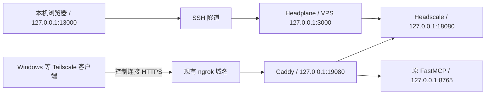

# Headscale 与 Headplane 安装、客户端接入及网页登录教程

整理日期：2026-10-29。适用场景：Vultr 公网 VPS，Ubuntu 26.04 LTS / x86_64，1 核、1 GB 内存、25 GB 硬盘；已有 Hysteria 和 FastMCP；使用一个现有 ngrok 免费域名，最多接入三台个人设备。

本文整合本次会话采用的方案和实际遇到的问题。真实公网 IP、ngrok 域名、账号和登记 ID 均使用占位或交互输入，不收录任何实际密钥。

快速定位：[Windows 客户端接入](#client-windows) · [Mac 客户端接入](#client-mac) · [Windows/Mac 登录 Headplane](#headplane-login) · [Headplane 缺字段故障](#headplane-startup-fix) · [停止与重新启动](#service-lifecycle)。

**最终状态：用户决定不再自建，已回传 Headscale 和 Headplane 停止并禁用开机自启，均为 `inactive` / `disabled`。共享 Caddy 继续保留为 FastMCP 的入口依赖，配置与数据不删除。** 本文保留此前部署、故障修复和接入步骤供参考；停用及以后重新启用的操作见 [第 13 节](#service-lifecycle)，不要从头重装。

## 1. 停用前的部署结构

- 自建 Headscale 控制服务，使用 Tailscale 官方公共 DERP，不自建 DERP。
- 共享现有 ngrok 域名，通过仅监听回环地址的 Caddy 分流 Headscale 和 FastMCP。
- 保留原 Hysteria、FastMCP、SSH 和防火墙配置。切换 ngrok 上游时会短暂重连，原 FastMCP gateway 进程应保持运行。
- Headplane 单独安装，通过 SSH 隧道供电脑浏览器访问，不加入现有 ngrok 公网分流。
- 不做备份。状态丢失后按新实例重建，用户和设备需要重新创建、登记。



Headscale 负责登记、策略与连接协调。设备间的数据优先直连，必要时经公共 DERP；不通过 ngrok 的控制入口转发这些业务数据。

| 组件 | 本次固定版本或用途 |
| --- | --- |
| Headscale | 0.29.6，官方 DEB、systemd、SQLite WAL |
| Caddy | 2.11.7，独立 `headscale-ingress.service` |
| Headplane | 0.8.2，独立 `headplane.service` |
| Node | 24.22.1，仅安装在 Headplane 专用目录 |
| Tailscale 客户端 | 使用与 Headscale 兼容的版本；本次发布基线要求至少 1.80.0 |

版本、下载摘要和官方资料统一见 [sources.md](./sources.md)。这些版本是本教程的固定基线，不代表今后始终为最新版本。

## 2. 文件、目录与端口

本教程依赖同一文件夹中的四个脚本：

| 文件 | 用途 |
| --- | --- |
| [rebuild.sh](./rebuild.sh) | Headscale 与独立 Caddy 的新实例预检、安装 |
| [configure-shared-ngrok.py](./configure-shared-ngrok.py) | 检查及修改已审阅的 FastMCP start/stop 脚本，只切换 ngrok 上游 |
| [install-headplane.sh](./install-headplane.sh) | Headplane 新实例预检与安装 |
| [fetch-headplane-app.py](./fetch-headplane-app.py) | 校验并提取固定官方镜像中的应用文件 |

**安装脚本统一放在 VPS 的 `/opt/headscale`。不要预先创建 `/opt/headplane` 来存脚本，它是面板的运行目录，安装器要求它尚不存在。**

| 地址或目录 | 用途 |
| --- | --- |
| 原 SSH 端口、UDP/443 | 原管理通道、Hysteria，保持现状 |
| `127.0.0.1:8765` | 原 FastMCP |
| `127.0.0.1:18080` | Headscale HTTP/API |
| `127.0.0.1:19080` | ngrok 的新上游，Caddy 分流入口 |
| `127.0.0.1:50443` | Headscale 管理 gRPC，不开放公网 |
| VPS `127.0.0.1:3000` | Headplane 网页面板，仅回环监听 |
| 电脑 `127.0.0.1:13000` | SSH 隧道的本地入口 |
| `/etc/headscale/config.yaml` | Headscale 配置 |
| `/etc/headscale/policy.hujson` | 文件模式的访问策略 |
| `/var/lib/headscale` | 节点身份、数据库等状态 |
| `/etc/headscale-ingress/Caddyfile` | 共享域名分流配置 |
| `/opt/headplane` | 面板应用和专用 Node 运行时 |
| `/etc/headplane/config.yaml` | 面板配置 |
| `/var/lib/headplane` | 面板自己的数据库和状态 |

不为本方案新增 VPS 公网 80、443、3000 或 3478 入站规则。客户端访问 ngrok 的 HTTPS/443，由 ngrok 终止 TLS。

## 3. 上传文件与 VPS 基线检查

### 3.1 在资料所在电脑上传

在四个脚本所在的本机目录打开终端。下面使用会话中的 root SSH 方式；将占位 IP 换成自己平时登录 VPS 使用的地址。

```bash
VPS_SSH='root@你的VPS公网IP'
```

```bash
ssh "$VPS_SSH" 'mkdir -p /opt/headscale'
```

```bash
scp rebuild.sh configure-shared-ngrok.py install-headplane.sh fetch-headplane-app.py "$VPS_SSH:/opt/headscale/"
```

```bash
ssh "$VPS_SSH"
```

自定义 SSH 端口：`ssh` 加 `-p 端口`，`scp` 加 `-P 端口`。不要上传本地脱敏后的整份 FastMCP 源码覆盖线上应用。

### 3.2 在 VPS 检查环境

```bash
cat /etc/os-release; uname -m; free -h; df -h /; sudo ss -lntup
```

确认原 Hysteria 和 FastMCP 原本正常，18080、19080、50443 未被占用；以后安装面板还要确认 3000 未被占用。会话中面板安装前可用内存约 694 MiB、磁盘剩余约 14 GiB，这只是当时的测量。

以下命令以本次已审阅的 FastMCP 部署目录 `/opt/gitee-mcp-gateway/gateway` 为准。目录或启动方式不同，应先核对原部署，不能把未知脚本强行改成示例。

## 4. 安装 Headscale

### 4.1 设置现有 ngrok 域名

在 VPS 的 Bash 会话执行：

```bash
cd /opt/headscale
```

```bash
read -r -p '输入现有 ngrok 域名，不含 https://、端口或路径: ' HS_HOST
```

输入类似 `your-assigned-name.ngrok-free.dev` 的裸域名。这里不填 `https://`，也不加 `/mcp`。后面客户端使用的登录 URL 才需要 `https://`。

### 4.2 先运行只读预检

```bash
sudo env HEADSCALE_HOSTNAME="$HS_HOST" bash ./rebuild.sh --check
```

预期出现 `Preflight passed` 和 `Read-only check finished`。检查要求原 FastMCP 未认证请求返回 401，并要求 Headscale 和独立代理没有既有安装状态；不会下载、安装或启停服务。

再以原 FastMCP 脚本所属账号执行：

```bash
python3 /opt/headscale/configure-shared-ngrok.py --gateway-dir /opt/gitee-mcp-gateway/gateway --check
```

预期包括 `syntax valid` 与 `Read-only check passed`。首次出现 `patch required` 正常，表示尚未改上游。

### 4.3 安装新服务

确认以上检查通过后：

```bash
sudo env HEADSCALE_HOSTNAME="$HS_HOST" bash ./rebuild.sh --install
```

脚本校验固定发布资产，写入 Headscale、策略和独立 Caddy 配置，启动 `headscale`、`headscale-ingress`。它不会替您切换原 ngrok。

配置采用回环 HTTP、公共 DERP、关闭内置 DERP、关闭 MagicDNS 和客户端 DNS 接管。默认策略允许同一用户自己的未打标签节点互访；“最多三台”是使用约定，不是程序硬配额。

### 4.4 验证本地分流

```bash
curl --noproxy '*' --connect-timeout 5 --max-time 15 -sS -w '\nHeadscale HTTP %{http_code}\n' -H "Host: $HS_HOST" http://127.0.0.1:19080/health
```

```bash
curl --noproxy '*' --connect-timeout 5 --max-time 15 -sS -o /dev/null -w 'FastMCP HTTP %{http_code}\n' -H 'Accept: application/json, text/event-stream' -H "Host: $HS_HOST" http://127.0.0.1:19080/mcp
```

预期：第一条返回 `{"status":"pass"}` 和 200，第二条返回 401。401 表示认证门仍在，并不等于 FastMCP OAuth 和工具调用已完成验收。

安装失败时读日志，不删除身份目录强行重跑：

```bash
sudo journalctl -u headscale -u headscale-ingress -n 80 --no-pager
```

## 5. 将原 ngrok 切换到共享入口

本节只适用于本次由 `start.sh` / `stop.sh` 管理、且已通过精确补丁检查的部署。使用原服务账号；本次原账号是 root。

下面这一整行会先应用补丁，再只重连 ngrok，并比对 gateway 的完整进程记录。任一步失败都会停止：

```bash
bash -c 'set -euo pipefail; python3 /opt/headscale/configure-shared-ngrok.py --gateway-dir /opt/gitee-mcp-gateway/gateway --apply; cd /opt/gitee-mcp-gateway/gateway; before=$(cat run/gateway.pid); bash ./stop.sh --ngrok-only; bash ./start.sh; after=$(cat run/gateway.pid); test "$before" = "$after"; printf "%s\n" "切换完成，gateway 进程记录未变。"'
```

预期看到 gateway 已运行、ngrok 重新启动，最后进程记录未变。公网入口会短暂重连；不要使用无参数 `stop.sh`，因为原默认行为会同时停止 gateway。

需要手动恢复原 ngrok 上游时，使用以下明确的回退步骤；这不会恢复 Headscale 数据：

```bash
bash -c 'set -euo pipefail; cd /opt/gitee-mcp-gateway/gateway; bash ./stop.sh --ngrok-only; python3 /opt/headscale/configure-shared-ngrok.py --gateway-dir /opt/gitee-mcp-gateway/gateway --revert; bash ./start.sh'
```

不使用 `pkill`、`killall` 或重启 VPS 代替这次切换。脚本拒绝未知版本时先核对，不绕过校验。

## 6. 验证 Windows 到公网入口

Windows 安装官方 Tailscale 客户端；已经安装的跳过。打开 PowerShell，先在这个窗口设置地址，VPS 的变量不会传到 Windows：

```powershell
$HsHost = Read-Host '输入现有 ngrok 域名，不含 https:// 或路径'; $HsServer = "https://$HsHost"
```

逐条执行，每条均为一整行：

```powershell
curl.exe --noproxy "*" --connect-timeout 5 --max-time 15 -sS -w "\nHeadscale HTTP %{http_code}\n" -H "ngrok-skip-browser-warning: 1" "$HsServer/health"
```

```powershell
curl.exe --noproxy "*" --connect-timeout 5 --max-time 15 -sS -o NUL -w "FastMCP HTTP %{http_code}\n" -H "ngrok-skip-browser-warning: 1" -H "Accept: application/json, text/event-stream" "$HsServer/mcp"
```

预期是健康信息加 200、FastMCP 401。使用 `curl.exe` 可避免 Windows PowerShell 中 `curl` 别名的差异。`ngrok-skip-browser-warning` 请求头用于跳过免费提示页，见 [ngrok 官方说明](https://ngrok.com/docs/pricing-limits/free-plan-limits#removing-the-interstitial-page)。

## 7. 创建用户并接入 Windows、macOS 客户端

### 7.1 在 VPS 创建个人用户

```bash
sudo headscale users create owner
```

```bash
sudo headscale users list
```

如果 `owner` 已存在，核对列表后继续，不删除或重建已有用户。参考 [Headscale 用户与登记说明](https://headscale.net/stable/usage/getting-started/)。

<a id="client-windows"></a>

### 7.2 在 Windows 发起登录

以管理员身份打开 PowerShell；如果是新窗口，需要重新设置上一节的 `$HsServer`。使用默认安装位置执行：

```powershell
& "$env:ProgramFiles\Tailscale\tailscale.exe" login --login-server="$HsServer" --accept-dns=false
```

命令会输出登记链接，或自动打开浏览器。已有其他 Tailscale 账户时不先清除客户端状态；本次接入会使用自建网络，同一设备的活动网络需要按客户端实际状态确认。[Windows 官方接入指南](https://headscale.net/stable/usage/connect/windows/)

保持登录窗口打开，打开类似下列结构的链接：

```text
https://你的ngrok域名/register/hskey-authreq-该设备的登记ID
```

若出现 ngrok 浏览器提示页，按提示继续。这里是手动登记，不需要登录 Tailscale 官方控制台来审批。

### 7.3 在 VPS 授权这台设备

登记页面会显示 Auth ID 或审批命令。复制完整的 `hskey-authreq-...`，不要删掉前缀；不要把整个 URL 当作 Auth ID。

```bash
read -r -p '粘贴该设备完整 Auth ID: ' AUTH_ID
```

```bash
sudo headscale auth register --user owner --auth-id "$AUTH_ID" && sudo headscale nodes list
```

预期出现 `Node ... registered`，并列出分配的 Tailscale IP。本次第一台 Windows 获得 `100.64.0.1`，新实例或后续设备以实际分配为准。

### 7.4 确认客户端与服务端都在线

Windows 新开 PowerShell：

```powershell
& "$env:ProgramFiles\Tailscale\tailscale.exe" status
```

示例：

```text
100.64.0.1  windows-client  owner  windows  -
```

VPS 再查：

```bash
sudo headscale nodes list
```

`Connected=online`、`Expired=no`，并且 Windows 显示相应节点，是本次首台设备的接入证据。审批后立即查到 `offline` 时，先看 Windows 登录是否完成，再查一次；持续离线则继续看客户端与服务端日志。

第二、三台设备各自发起登录、取得自己的 Auth ID，并登记到 `owner`，不能重复使用第一台设备的登记 ID。

<a id="client-mac"></a>

### 7.5 接入 macOS 客户端

本节把 Mac 注册为可与 Windows 互访的 Tailscale 节点，和第 9 节用 Mac 浏览器管理 Headplane 是两件独立的事。只打开管理面板不要求 Mac 加入 tailnet；要让 Mac 通过 Tailscale 访问其他客户端，就按本节登记。

#### 第一步：安装并打开官方客户端

按 [Tailscale macOS 安装说明](https://tailscale.com/docs/install/mac)安装官方客户端。尚未安装时可选官方推荐的 Standalone 版；已安装 App Store 版则沿用现有版本。按系统提示允许所需的 VPN 配置或网络扩展。

如果之前登录的是其他 Tailscale 网络，不清除客户端数据；本次添加自建控制服务器账户，活动账户切换后原网络的连接会相应变化。

#### 第二步：在 Mac 终端设置地址并发起登记

打开 Mac 的“终端”，输入现有 ngrok 裸域名，下面写法同时适用于常见的 zsh 和 Bash：

```bash
printf '输入现有 ngrok 裸域名: '; read -r HS_HOST; HS_SERVER="https://$HS_HOST"
```

先检查该 Mac 到控制入口的连通性：

```bash
curl --noproxy '*' --connect-timeout 5 --max-time 15 -sS -w '\nHeadscale HTTP %{http_code}\n' -H 'ngrok-skip-browser-warning: 1' "$HS_SERVER/health"
```

预期返回 pass 和 200，然后使用与安装方式相符的一种 CLI 入口：

- **Standalone 版**：在 Tailscale 的 Settings → CLI integration → Show me how → Install Now 安装命令行入口，然后在终端执行：

```bash
tailscale login --login-server="$HS_SERVER" --accept-dns=false
```

- **App Store 版**：可直接调用应用内置 CLI，无需另起一套服务：

```bash
TAILSCALE_BE_CLI=1 /Applications/Tailscale.app/Contents/MacOS/Tailscale login --login-server="$HS_SERVER" --accept-dns=false
```

入口及环境变量依据 [Tailscale macOS CLI 说明](https://tailscale.com/docs/reference/tailscale-cli?tab=macos)。如果应用安装位置不是 `/Applications/Tailscale.app`，将路径改成自己的实际位置。两种命令选一种，不重复发起登记。

可选的图形入口是：按住 **Option** 点击菜单栏 Tailscale 图标 → **Debug** → **Custom Login Server** → **Add Account...**，填完整 `https://你的ngrok域名`，继续浏览器登记。[Headscale macOS 接入说明](https://headscale.net/stable/usage/connect/apple/#macos)

若通过 GUI 登录，审批完成后再设置与本教程一致的 DNS 开关。Standalone CLI 执行：

```bash
tailscale set --accept-dns=false
```

App Store 内置 CLI 执行：

```bash
TAILSCALE_BE_CLI=1 /Applications/Tailscale.app/Contents/MacOS/Tailscale set --accept-dns=false
```

#### 第三步：在 VPS 审批 Mac 的新 Auth ID

保持 Mac 登录窗口打开，访问它新生成的登记链接。取得 **Mac 自己的完整 `hskey-authreq-...`**；不要使用 Windows 已用过的 ID，也不要把 Headplane 管理 API key 填进登记命令。

在 VPS 执行：

```bash
read -r -p '粘贴 Mac 的完整 Auth ID: ' AUTH_ID
```

```bash
sudo headscale auth register --user owner --auth-id "$AUTH_ID" && sudo headscale nodes list
```

Windows 已经使用的 `owner` 可以直接复用，不需要给 Mac 再建一名用户。当前策略允许同一用户自己的未打标签设备互访。

#### 第四步：确认在线并测试 Mac 与 Windows 互访

Standalone 版在 Mac 终端执行：

```bash
tailscale status
```

```bash
tailscale ip -4
```

App Store 版相应执行：

```bash
TAILSCALE_BE_CLI=1 /Applications/Tailscale.app/Contents/MacOS/Tailscale status
```

```bash
TAILSCALE_BE_CLI=1 /Applications/Tailscale.app/Contents/MacOS/Tailscale ip -4
```

回到 VPS，确认 Mac 对应节点也显示 `Connected=online`：

```bash
sudo headscale nodes list
```

Mac 的 IP 以 `ip -4` 的实际输出为准，不预先固定为某个地址。如果 Windows 仍是本次的 `100.64.0.1`，在 Mac 测试：

```bash
tailscale ping 100.64.0.1
```

App Store 版测试命令：

```bash
TAILSCALE_BE_CLI=1 /Applications/Tailscale.app/Contents/MacOS/Tailscale ping 100.64.0.1
```

Windows 反向测试时，把下面占位值换成刚查到的 Mac IP：

```powershell
& "$env:ProgramFiles\Tailscale\tailscale.exe" ping 'Mac实际的Tailscale-IP'
```

通过后再访问需要的具体业务；业务服务还需实际监听相应接口并受设备本机防火墙允许。两台电脑当前同处局域网，成功互访可以走局域网直连，不代表已经验证异地网络或公共 DERP 中继。本节是新增接入指南，会话中尚未回传 Mac 实际登记结果。

## 8. 安装 Headplane 网页管理面板

### 8.1 安装方式与功能范围

Headscale 没有内置完整管理网页。本教程的 Headplane 由本项目脚本提取固定官方镜像里的预编译应用，再使用专用 Node 原生运行；这是本项目的交付封装，不是官方原生应用发行压缩包。不需要在 VPS 安装 Docker、Go、npm、pnpm，也不迁移现有 Headscale。[官方原生运行说明](https://headplane.net/install/native-mode)

面板使用独立账号和新目录，现有 Headscale 配置、文件 ACL 保持只读。可以通过 API 管理设备、用户、预认证密钥和路由审批；不开启 agent、浏览器 SSH 或 OIDC。路由审批不等于同时授权了局域网访问，本教程未配置子网路由或出口节点。

面板只绑定 `127.0.0.1:3000`。服务设置 CPU 50%、内存硬上限 384 MiB、Node 堆上限 192 MiB；这只是对新面板的运行限制，实际页面负载仍需验收。

### 8.2 预检与安装

确认 `install-headplane.sh`、`fetch-headplane-app.py` 均在 `/opt/headscale`，并使用包含 `pod_name` 修正的最新版脚本。

```bash
free -h; df -h /; sudo ss -lntp '( sport = :3000 )'
```

```bash
cd /opt/headscale && sudo bash ./install-headplane.sh --check && sudo bash ./install-headplane.sh --install
```

预检要求：Linux amd64、原 Headscale 健康、3000 空闲、至少 480 MiB 可用内存及 1 GiB 空闲磁盘，而且没有旧 Headplane 账号、目录或服务。安装先下载和校验，再创建新面板状态；不修改 ngrok、防火墙或原有服务配置，不创建 API key。

### 8.3 检查服务是否真正就绪

```bash
sudo systemctl show headplane -p ActiveState -p SubState -p Result -p ExecMainStatus -p NRestarts -p MemoryPeak
```

```bash
curl --noproxy '*' --connect-timeout 5 --max-time 15 -sS -o /dev/null -w 'Headplane HTTP %{http_code}\n' -H 'Host: 127.0.0.1:13000' http://127.0.0.1:3000/admin
```

正常应保持运行，HTTP 返回页面或登录重定向，常见为 200 或 302。如果出现 `UI not ready`、持续 `auto-restart` 或 HTTP 000，先处理第 10 节故障，暂不进入网页登录。

<a id="headplane-login"></a>

## 9. 在 Windows 或 macOS 浏览器登录 Headplane

### 9.1 在需要打开面板的电脑建立 SSH 隧道

Windows 和 Mac 二选一；如果两台都要打开面板，就在两台电脑各自建立隧道。它们各用自己的 `127.0.0.1:13000`，不会互相占用端口。Windows 的本地隧道不会因为两台电脑同处局域网就自动共享给 Mac。

#### Windows：使用 PowerShell

Windows PowerShell 执行这一行，将主机地址替换为自己平时 SSH 登录 VPS 使用的公网 IP 或 SSH 别名：

```powershell
ssh -N -o ExitOnForwardFailure=yes -L 127.0.0.1:13000:127.0.0.1:3000 root@你的VPS公网IP
```

若 SSH 使用其他端口：

```powershell
ssh -p 你的SSH端口 -N -o ExitOnForwardFailure=yes -L 127.0.0.1:13000:127.0.0.1:3000 root@你的VPS公网IP
```

#### macOS：使用终端 Terminal

在 Mac 打开“终端”（Terminal），执行这一整行，使用自己平时 SSH 登录 VPS 的地址：

```bash
ssh -N -o ExitOnForwardFailure=yes -L 127.0.0.1:13000:127.0.0.1:3000 root@你的VPS公网IP
```

如果已经配置 SSH 别名，例如 `my-vps`，最后一项也可以替换为自己的别名。非默认 SSH 端口时：

```bash
ssh -p 你的SSH端口 -N -o ExitOnForwardFailure=yes -L 127.0.0.1:13000:127.0.0.1:3000 root@你的VPS公网IP
```

保持 Mac 的这个终端窗口打开，然后按下面的步骤在同一台 Mac 的 Safari、Chrome 等浏览器登录。这里只建立 SSH 管理通道，不需要为了打开面板在 Mac 新注册 Tailscale 节点，也不需要配置 Windows 子网路由。

#### 两种系统共同注意事项

按原 SSH 方式使用密钥或输入密码；首次连接核对主机指纹。**这个地址是 VPS 的 SSH 主机地址，不是 ngrok HTTPS 域名，也不是 Windows 的 `100.64.0.1`。**

认证成功后，`ssh -N` 通常保持安静、不返回提示符，这是正常的隧道运行状态。保持这个窗口打开；需要管理 VPS 命令时另开原 SSH 会话。关闭隧道窗口后，浏览器的该入口将不可达。

### 9.2 打开准确的面板地址

在运行隧道的同一台 Windows 或 Mac 的浏览器中打开：

```text
http://127.0.0.1:13000/admin
```

这里使用 HTTP；电脑与 VPS 之间由 SSH 隧道加密。保持 `127.0.0.1`、端口 `13000` 与路径 `/admin` 不变，与面板配置的 `server.base_url` 一致，避免登录动作的 Host/Origin 检查失败。

不要打开 ngrok 域名的 `/admin`：目前该公网路径仍默认进入 FastMCP。也不要直接打开 VPS 公网 IP 的 3000 端口：服务只监听回环地址。

### 9.3 在 VPS 创建登录 API key

另开一个 VPS SSH 会话，执行：

```bash
sudo headscale apikeys create --expiration 90d
```

复制命令返回的完整 API key。**仅把它粘贴进自己的 Headplane 登录框，不贴进聊天、教程、截图或 Git 仓库。**

### 9.4 填写密钥并登录

1. 在 Headplane 登录页选择或使用 **API key** 登录方式。
2. 粘贴上一步生成的 Headscale API key。
3. 点击页面上的登录按钮。
4. 登录后打开设备列表，确认可以看到先前登记的 Windows、其 Tailscale IP 和在线状态。

Windows 和 Mac 的浏览器分别登录；Mac 可以使用同一枚仍有效的管理 API key，也可以在 VPS 单独创建一枚。不要通过聊天传递密钥，新增一次浏览器登录不会新增 Tailscale 节点。

本方案没有配置用户名/密码登录或 OIDC。`owner` 是 Headscale 中设备所属用户，不是 Headplane 登录密码；VPS 的 root 密码也不填进面板。

| 值 | 用途 |
| --- | --- |
| `hskey-authreq-...` | 单台设备的待审批登记 ID，用于 `headscale auth register` |
| `headscale apikeys create` 返回的 API key | Headplane 管理登录，具有管理权限 |
| 预认证密钥 | 可用于设备非交互接入；本教程首台设备未使用 |
| 原 ngrok authtoken | 只供现有 ngrok agent 使用，本教程不读取或替换 |

### 9.5 日后重新登录

面板服务已随 VPS 启动；日常使用时，先在电脑重新建立 SSH 隧道，再打开同一浏览器地址。会话仍有效时可能直接进入面板，需要重新登录时使用未过期的 API key。

API key 到期或被撤销后，在 VPS 创建新 key 再登录。可用 `sudo headscale apikeys list` 查看 key 记录；撤销操作先查看 `sudo headscale apikeys expire --help`，只针对需要撤销的条目。

Headplane 0.8.2 的 API-key 登录会话可能按 API key 剩余有效期计算，不能将配置中的 `cookie_max_age: 3600` 当作强制一小时退出。浏览器 cookie 同样需要保密；结束管理时使用面板退出功能，并关闭 SSH 隧道。

## 10. 本次会话遇到的问题及处理

### 10.1 域名校验拒绝

错误：`Use the existing lowercase bare hostname...`。

VPS 安装参数 `HEADSCALE_HOSTNAME` 要裸域名，例如 `your-assigned-name.ngrok-free.dev`；Windows 的 `--login-server` 要完整 HTTPS URL。这两个值的格式不能混用。

### 10.2 start.sh 指纹不匹配

本次曾因 VPS 的 `start.sh` 末尾多了一个 LF 换行而误报。新版 `configure-shared-ngrok.py` 已仅对末尾 LF 归一化，保留真实 URL 和文件原始尾部；正文变更仍会拒绝。

重新上传最新版工具后先执行 `--check`。不要用脱敏源码覆盖线上 start/stop，不绕过指纹验证。

### 10.3 Windows 命令没有反应或 TLS 握手失败

若 PowerShell 显示续行等待，先按 Ctrl+C，重新粘贴一整行命令。需要看网络过程时：

```powershell
curl.exe --noproxy "*" --connect-timeout 5 --max-time 15 -v -H "ngrok-skip-browser-warning: 1" -H "Accept: application/json, text/event-stream" "$HsServer/mcp"
```

`curl (35)` 和 HTTP 000 表示 TLS 阶段没有拿到 HTTP 响应，不能据此判定 FastMCP 应用故障。会话中后续请求返回了 401，但该次握手失败的根因没有确认；不把关闭证书验证作为修复。

### 10.4 安装文件误放到 /opt/headplane

**仅在目录只是存放这两个安装文件、尚未安装面板时**，可移回正确目录并删除空目录：

```bash
sudo mv -n /opt/headplane/install-headplane.sh /opt/headplane/fetch-headplane-app.py /opt/headscale/ && sudo rmdir /opt/headplane
```

`rmdir` 遇到其他文件会拒绝删除。若 `/opt/headplane` 已有 runtime、app 或实际安装状态，保留目录排查，不能按误放文件处理。

<a id="headplane-startup-fix"></a>

### 10.5 Headplane 缺少 integration.kubernetes.pod_name

本次实际日志为：

```text
Unable to load configuration:
integration.kubernetes.pod_name must be a string (was missing)
```

这是旧版安装模板遗漏字段。0.8.2 即使设置 `enabled: false`，仍要求该块通过完整 schema 校验。[固定版本 schema](https://github.com/tale/headplane/blob/v0.8.2/app/server/config/integration/kubernetes.ts#L18)

在 VPS 用现有编辑器打开 `/etc/headplane/config.yaml`，将 `integration` 下的 Kubernetes 小节补齐为以下内容；保留其他配置和密钥路径：

```yaml
  kubernetes:
    enabled: false
    pod_name: "headscale"
```

不要添加第二个同名 `kubernetes` 小节，也不要改为启用。最新版安装脚本已经包含该字段，但重新上传安装脚本不会自动修补已生成的 VPS 配置。

保存后仅重启面板：

```bash
sudo systemctl restart headplane
```

重新执行第 8.3 节服务与 HTTP 检查，再进行第 9 节登录。本次用户已回传修复后 HTTP 302，并提供浏览器中的新增设备对话框截图；这些是该实例的用户回传证据。

### 10.6 UI not ready 或服务持续重启

在 VPS 读取状态与日志：

```bash
sudo systemctl show headplane -p ActiveState -p SubState -p Result -p ExecMainStatus -p NRestarts -p MemoryPeak; sudo journalctl -u headplane -b -n 60 --no-pager -o cat
```

日志中来自 `xfs_scrub_all.service`、`system-xfs_scrub.slice` 的 `CPUAccounting` 旧选项提示，不是本次确认的配置错误；实际致命错误以上面的缺字段日志为准。不要仅因就绪超时就放宽权限、增加内存限制、重装或删除状态。

### 10.7 浏览器打不开或无法登录

| 现象 | 先检查 |
| --- | --- |
| SSH 报本地端口占用 | 是否已有同一个隧道窗口；不要重复启动相同监听 |
| SSH 报连接目标 3000 失败 | VPS 上 Headplane 是否运行、是否有本地 HTTP 响应 |
| 浏览器拒绝连接 | 隧道是否保持打开，是否在同一台电脑打开地址 |
| 请求进入 FastMCP 或返回其 401 | 是否误用了 ngrok 域名的 `/admin` |
| 登录动作被拒绝、Origin 不匹配 | 是否严格使用 `http://127.0.0.1:13000/admin` |
| 提示 API key 无效 | 是否粘贴了正确的 Headscale API key，是否过期；不要误用 Auth ID 或 ngrok token |

## 11. 验收、日常管理与重建

### 11.1 可用性验收

- Headscale：Windows 客户端正常列出节点，VPS 对应节点显示 online。
- Headplane：浏览器经 SSH 隧道登录成功，设备页显示已登记客户端；不只看 systemd active。
- 共存服务：原 Hysteria 客户端可用；FastMCP 原 OAuth、列工具及一次既有只读调用正常。HTTP 401 不能替代这些操作。
- 多设备：第二台接入后实际互访，再检查直连或公共 DERP 路径。

Windows 公共 DERP 与多设备检查命令：

```powershell
& "$env:ProgramFiles\Tailscale\tailscale.exe" netcheck
```

```powershell
& "$env:ProgramFiles\Tailscale\tailscale.exe" debug derp-map
```

```powershell
& "$env:ProgramFiles\Tailscale\tailscale.exe" ping '另一台客户端的Tailscale-IP'
```

只有一台客户端时，无法完成两台设备互访验收。能直连是正常结果，无需强制使用中继。客户端数少也不代表免费 ngrok 月额度一定足够，实际使用查看自己的 ngrok Usage。

### 11.2 常用只读命令

```bash
sudo headscale nodes list
```

```bash
sudo headscale users list
```

```bash
sudo headscale nodes list-routes
```

```bash
sudo systemctl status headscale headscale-ingress headplane --no-pager
```

```bash
free -h; df -h /; sudo systemctl show headplane -p MemoryCurrent -p MemoryPeak
```

### 11.3 不做备份时的边界

重建脚本是新实例安装入口，不是覆盖修复工具。已有状态会被检查并拒绝覆盖；不能通过删除目录来“解决”预检错误。没有备份时，丢失 `/var/lib/headscale` 就不能恢复旧节点身份，需要重新建用户并逐台登记。

Windows 的 `100.64.0.1` 属于 Windows 本机。VPS 运行 Headscale 控制服务，并不自动获得 Tailscale 内网 IP。两台电脑同处局域网，也不会自动把 VPS 纳入这个网络；访问本教程的 Headplane 不需要配置 Windows Subnet Router。

### 11.4 本次会话的实际完成情况

| 项目 | 会话证据 |
| --- | --- |
| Headscale 与独立 Caddy 安装 | 用户回传安装完成及本地健康检查结果 |
| ngrok 共享入口切换 | 原 gateway 进程记录未变，ngrok 重新启动 |
| Windows 公网入口 | `/health` 返回 pass/200，`/mcp` 返回 401 |
| 第一台 Windows | 登记完成，客户端列出 `100.64.0.1`，VPS 显示 online |
| Mac 客户端 | 本文提供安装、登记、审批和互访步骤，尚无实际接入成功回传 |
| Headplane 应用与 Node | 下载校验、应用提取与服务创建已完成；日志确认 Node 24.22.1 |
| Headplane 启动 | 原缺少 `integration.kubernetes.pod_name`，补齐后用户回传 HTTP 302 |
| 浏览器面板 | 用户提供新增设备对话框截图，Owner 列表显示 `owner`；实际 SSH 连接未由助手直接观察 |
| 多设备互访、DERP 实际中继、原业务完整回归 | 待实际验证 |
| 最终停用 | 用户回传 Headscale、Headplane 均为 `inactive` / `disabled`；仅停用两项自建服务 |

上表记录用户回传结果；本文整理没有登录或修改 VPS。详细研究与来源见 [README.md](./README.md)、[sources.md](./sources.md)。

## 12. ChatGPT 云端环境的 VPN 边界

本次没有配置云端接入，随后用户决定停用自建 Headscale 和 Headplane；没有迁移 Windows 到另一控制服务器。当前云端设置页的 Tailscale 认证密钥框没有自定义 Headscale 控制地址字段，不能把登记 ID 或 Headplane 管理 API key 填进去。当前安装版本的配置模型与官方说明核验结果见 [方案记录](./README.md#13-chatgpt-云端内置-vpn本次不接入) 和 [来源记录](./sources.md#chatgpt-云端-vpn-核验)。没有实际创建云端任务、保存 VPN 密钥或验证云端到局域网的连接。

<a id="service-lifecycle"></a>

## 13. 服务停止与重新启动

本节 `systemctl` 和 `curl` 命令均在 **VPS 的 SSH 终端**执行。重新启动步骤供以后需要时使用，本次文档整理没有执行这些操作。

### 13.1 停止并禁用开机自启（已执行）

用户于 2026-10-29 在 VPS 执行以下单行命令，回传两项服务均为 `ActiveState=inactive`、`UnitFileState=disabled`：

```bash
sudo systemctl disable --now headplane headscale && sudo systemctl show headplane headscale -p Id -p ActiveState -p UnitFileState
```

该操作停止 Headscale、Headplane 并取消它们的开机自启，不卸载软件，不删除配置、用户、节点身份或数据库，也不创建备份。客户端不会因此被自动迁移到官方 Tailscale。

**共享 Caddy `headscale-ingress` 保留。** 当前 FastMCP 的公网路径仍配置为 `ngrok → 127.0.0.1:19080（Caddy）→ 127.0.0.1:8765（FastMCP）`，独立于被停用的控制服务。不要一起停止 Caddy；若以后也要停它，应先将 ngrok 恢复到原 FastMCP 上游 8765，并验证业务入口。

本次停用命令没有操作 Hysteria、FastMCP、ngrok 或防火墙；这些服务的业务状态不由上述两项 systemd 输出证明。Headscale 专用路径在控制服务停止后不可用，属于停用结果。

### 13.2 从停用状态重新启动

沿用原配置和数据库，无需重新执行 `rebuild.sh` 或 `install-headplane.sh`。先只读确认共享入口：

```bash
sudo systemctl is-active headscale-ingress
```

预期为 `active`。若不是，先检查该服务日志和现有 ngrok 上游，不重装或更改原网关配置。

以下两种方式按需要选一种。**仅启动本次运行，继续保持开机自启禁用：**

```bash
sudo systemctl start headscale && sudo systemctl start headplane
```

**启动服务，同时恢复开机自启：**

```bash
sudo systemctl enable --now headscale && sudo systemctl enable --now headplane
```

两种方式均先启动控制服务，再启动管理面板，不重启共享 Caddy、FastMCP、ngrok 或 Hysteria。`start` 不会自动撤销此前的 `disable`；需要开机自启时应使用第二种方式。

### 13.3 检查恢复结果

启动后等待约 15 秒，再在 VPS 查看状态：

```bash
sudo systemctl show headscale headplane -p Id -p ActiveState -p UnitFileState
```

两项服务应为 `ActiveState=active`。仅临时启动时，`UnitFileState=disabled` 是预期结果；恢复开机自启后应为 `enabled`。

依次检查 Headscale、面板和原 FastMCP 入口，每条均为单行：

```bash
curl --noproxy "*" --max-time 10 -sS -o /dev/null -w "Headscale HTTP %{http_code}\n" http://127.0.0.1:18080/health
```

```bash
curl --noproxy "*" --max-time 10 -sS -o /dev/null -w "Headplane HTTP %{http_code}\n" -H "Host: 127.0.0.1:13000" http://127.0.0.1:3000/admin
```

```bash
curl --noproxy "*" --max-time 10 -sS -o /dev/null -w "FastMCP HTTP %{http_code}\n" -H "Accept: application/json, text/event-stream" http://127.0.0.1:19080/mcp
```

预期分别为 Headscale `200`、Headplane `302`（或页面 `200`）、FastMCP `401`。这些只证明对应 HTTP 路由响应；仍需检查客户端重新在线、浏览器登录，以及原 FastMCP 的既有业务调用。失败时回到第 10 节读取对应服务日志，不删除状态强行重装。

之后在 Windows 或 Mac 客户端查看连接状态，在 VPS 用 `sudo headscale nodes list` 确认原节点重新在线。需要管理面板时，保持原 SSH 隧道；若隧道已关闭，按 [第 9 节](#headplane-login)重新建立，然后访问 `http://127.0.0.1:13000/admin`，使用仍有效的 API key 登录。不要重复启动已占用本机 13000 端口的隧道。

### 13.4 日常临时停止或重启

以下命令供服务恢复使用后按需要选择，在 VPS 执行：

| 目的 | 单行命令 | 影响 |
| --- | --- | --- |
| 临时停止管理面板 | `sudo systemctl stop headplane` | 不停止 Headscale，开机自启设置不变 |
| 临时停止控制面和面板 | `sudo systemctl stop headplane headscale` | 控制连接与管理面板不可用，开机自启设置不变 |
| 重启管理面板 | `sudo systemctl restart headplane` | 管理页面短暂不可用，不重启控制服务 |
| 重启控制服务 | `sudo systemctl restart headscale` | 控制连接短暂重连，不重启共享 Caddy |

`restart` 也不会改变开机自启设置。以上命令不用于停止共享 `headscale-ingress`；若不再使用自建服务，使用第 13.1 节的停止并禁用命令。
